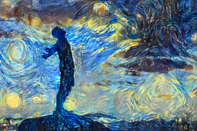

# Neural Style Transfer with VGG19 (PyTorch)

A PyTorch implementation of neural style transfer (Gatys et al.): the pixels of an image are optimized with L-BFGS so that its VGG19 features match the **content** of one image and its Gram-matrix statistics match the **style** of another. The repo includes an experiment framework that runs a 3 × 3 grid over the initialisation and learning rate and saves images, loss histories and reports. Final project of Pattern Recognition and Computer Vision (CS 5330, Northeastern University, Spring 2025). The report is [`PRCV_Project_6_Report.pdf`](PRCV_Project_6_Report.pdf).



## How it works

- **Features:** frozen VGG19 (ImageNet weights) via `create_feature_extractor`; content from `relu_4_2`; style from `relu_1_1`, `relu_2_1`, `relu_3_1`, `relu_4_1`, `relu_5_1`.
- **Losses:** content = MSE of features; style = MSE of Gram matrices (normalised by feature-map size); total variation for smoothness. Total = content·w_c + style·w_s + TV·w_tv.
- **Optimizer:** `torch.optim.LBFGS` with a closure over the image pixels.
- **Initial image:** `input = noise·(1 − r) + content·r`, where `r` is `--noise_ratio` (0 = pure noise, 1 = the content image). Despite its name, a higher `noise_ratio` means *more content* in the starting image.

## Repository layout

```
Code Files/main.py            run style transfer (command line)
Code Files/utils.py           image I/O, content / Gram / TV losses, loss plotting
Code Files/run_parameters.py  grid over noise_ratio {0.3, 0.5, 0.7} x learning_rate {0.4, 0.7, 1.0}
Code Files/analysis.py        plot a saved loss history
imgs/                         content and style images
outputs/                      36 grid runs + extra examples (final.png, iter_*.png, loss_history.npy, report.json)
```

## Setup

Python 3.8+ with a CUDA GPU recommended (every committed run used CUDA; CPU works but is slow).

```bash
pip install torch torchvision numpy matplotlib pillow tqdm
```

## Usage

```bash
cd "Code Files"
# one style transfer (defaults: 256 px, style weight 50, TV weight 0.5, 1000 iterations)
python main.py --content_image ../imgs/golden_gate.jpg --style_image ../imgs/starry_night.jpg \
               --noise_ratio 0.5 --learning_rate 0.7 --style_loss_weight 10 --tv_loss_weight 0.5 \
               --iteration 1000 --imsize 256 --save_freq 250 --save_path ../outputs/

# the full parameter grid (9 runs)
python run_parameters.py --content_image ../imgs/golden_gate.jpg --style_image ../imgs/sunset.jpeg \
                         --iterations 1000 --imsize 256 --output_dir ../outputs

# plot a loss history
python analysis.py --loss_file ../outputs/<run>/loss_history.npy --output_dir ../analysis
```

Each run writes `final.png`, intermediate `iter_N.png`, `loss_history.npy` (10,000 recorded steps) and `report.json` (time, final losses, arguments).

## Experiment results (36 saved runs)

Computed from the committed `report.json` files (256 × 256 images, content weight 1, style weight 10, TV weight 0.5; 500 iterations for the bridge set and 1,000 for the others):

| Finding | Evidence |
|---|---|
| A higher content share in the initial image starts with a much lower content loss | Bridge set: about 6.6 (r = 0.3) vs 3.9 (0.5) vs 1.6 (0.7) |
| It also ends with a slightly lower content loss | About 0.2 to 0.3 lower at r = 0.7 |
| Lower r gives slightly lower final style loss only in some sets | Bridge: about 0.29 vs 0.31; no difference for Starry Night and Sunset |
| Learning rate (0.4, 0.7, 1.0) barely changes final losses | Differences below about 0.01 in style loss and 0.3 in total loss |
| Run time does not depend on the parameters | Mostly 965 to 1,520 s; one 5,005 s outlier |

The report's statements about convergence speed and learning-rate effects are therefore mostly qualitative impressions of the images and loss curves; no perceptual metric (SSIM, LPIPS) is reported.

## Known limitations

- Images are processed at 256 px; larger sizes need more memory and time.
- One run per setting and no perceptual evaluation.
- The older README mentioned a `loss.py`, which does not exist (the loss functions are in `utils.py`).
- Absolute Windows paths are stored inside each `report.json`.
- The repo is about 108 MB because of saved outputs.

## Ideas

Feed-forward or AdaIN style transfer for real-time speed, multi-scale optimisation, SSIM/LPIPS evaluation, a Gradio demo and video with temporal consistency.

## References

Gatys, Ecker and Bethge (2016), *Image Style Transfer Using Convolutional Neural Networks*; Johnson, Alahi and Fei-Fei (2016), *Perceptual Losses for Real-Time Style Transfer and Super-Resolution*; Mahendran and Vedaldi (2015), *Understanding Deep Image Representations by Inverting Them*.

## License

No license file yet; add one (for example MIT).
